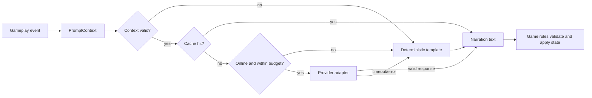

# 灰冠王国 / Greycrown

Greycrown 是一个使用 Godot 4.6 开发的完整卡牌 RPG。玩家从据点管理牌组与角色状态，前往不同城区收集情报、处理委托并与 NPC 互动，再通过仪式锻造强化卡牌，进入高塔完成战斗、事件、商店、神龛和 Boss 楼层，最终把获得的资源与世界状态带回下一轮循环。

本仓库包含可运行的 Godot 客户端、数据与场景、运行时美术和 BGM、完整测试源码，以及一个可独立构建和测试的 TypeScript/WebSocket 权威服务端原型。当前游戏主循环采用本地优先设计，不启动服务端、不配置模型密钥也可以运行。

## 快速概览

| 项目 | 当前实现 |
| --- | --- |
| 游戏类型 | 回合制卡牌 RPG、城市探索、仪式锻造与高塔推进 |
| 客户端 | Godot 4.6.x、GDScript、Dialogic、Compatibility Renderer |
| 主场景 | `client/scenes/hub/hub.tscn` |
| 核心状态 | 牌组、卡牌、烙印、金币、AP、时间、天气、污染、途径/序列、NPC 关系与世界事件 |
| AI GM | 结构化上下文、缓存、预算、Provider 边界、有限重试与确定性模板降级 |
| 服务端 | TypeScript、WebSocket、协议校验、AOI、快照、战斗锁与管理检查面 |
| 运行时媒体 | 229 张 PNG、7 首 MP3 BGM，以及带静音降级的 SFX 路由 |
| 自动化验证 | Godot 测试、Vitest、TypeScript 构建、Web 导出与 Playwright WebQA |

## 核心游戏循环

1. **据点准备**：查看角色和世界状态，整理牌组，管理卡牌与烙印，选择锻造、冥想、休息、情报或外出行动。
2. **城市行动**：消耗 AP 在城区热点间行动，与 NPC 对话，接受委托，收集真假情报，触发工作、演练、交易、小游戏和遭遇事件。
3. **构筑成长**：通过掉落、商店、黑市、仪式锻造和重铸调整牌组，积累途径经验并处理污染、教会关注等长期状态。
4. **高塔探索**：进入按地区、规模和种子生成的高塔，依次解决战斗、事件、商店、神龛和 Boss 楼层，也可以在风险过高时撤退。
5. **结算推进**：战斗结果、委托结果、NPC 关系、时间和世界事件回写到 `GameState`，成为后续对话、遭遇与高塔内容的条件。
6. **叙事呈现**：AI GM 根据已经确定的游戏状态生成或降级渲染叙事文本，但不直接修改数值和规则结果。

## Godot 客户端

### 运行时基础与状态管理

`client/project.godot` 使用 1280x720 逻辑视口和兼容渲染器，启动入口为 Hub。项目注册了以下 Autoload：

| Autoload | 职责 |
| --- | --- |
| `SymbolLibrary` | 加载仪式符号定义并提供查询 |
| `ReactionTable` | 管理符号组合对应的仪式反应 |
| `GameState` | 保存玩家、牌组、世界、NPC、时间和进度状态 |
| `Bgm` | 加载 BGM 清单并负责播放、停止和场景间淡入淡出 |
| `Sfx` | 管理短音效播放器池和缺失音效的静音回退 |

状态层位于 `client/scripts/state/`。它负责账户/存档、AP、卡牌库存、烙印掉落与重铸、天气效果和可持久化世界状态。存档、模型设置和本地 QA 结果写入 Godot `user://`，不写入仓库。

大部分内容采用数据驱动方式组织在 `client/data/`，卡牌、技能、敌人、敌人包、城区、委托、遭遇、传闻、商店、神龛、高塔、天气和 AI GM 模板不集中硬编码在单个场景脚本中。

### 卡牌、牌组与烙印

卡牌系统由 `client/scripts/combat/`、`client/data/cards/` 和 `client/data/skills/` 共同组成：

- `CardLibrary` 从数据目录加载卡牌和技能，支持按途径、序列和掉落池查询；
- 卡牌数据描述费用、目标、效果、标签、序列、途径和美术资源；
- 牌组与卡牌库存支持查看、排序、筛选、加入、移除和销毁等操作；
- 临时卡牌和战斗内牌组与持久库存分离，避免战斗过程直接破坏长期状态；
- `BrandCatalog` 与烙印数据为卡牌附加伤害、治疗、穿透、吸血、抽牌、费用变化、多目标、回响等规则；
- Hub 中的牌组构筑器与烙印工坊负责把长期构筑操作接入玩家状态。

### 回合制卡牌战斗

主战斗系统由领域逻辑和表现层分开组成：

- `TurnBattle` 管理回合开始、抽牌、玩家行动、敌人行动、胜负与结果结算；
- `EffectEngine` 解析伤害、格挡、治疗、状态、抽牌、费用变化、多段攻击和条件效果；
- 敌人库、敌人包和敌人意图系统决定出场组合及下一步行动；
- 战斗 UI 支持卡牌拖放、目标校验、敌我立绘、状态说明、伤害反馈、牌堆查看和结果面板；
- 胜利结果可产生卡牌、烙印、金币和其他楼层掉落，再由高塔或世界系统决定如何写回长期状态；
- 合同、污染、途径和部分世界状态可以改变战斗前后规则，但最终结果仍由确定性代码计算。

仓库还保留了一组用于节奏交互的 Phigros 风格判定线、音符、输入和图表组件。其中可复用组件参与锻造等节奏阶段；三份未接入主循环且依赖缺失外部逻辑的旧实验场景被明确排除在 Web、Windows 和 Android 导出之外。

### 仪式锻造、重铸与序列成长

仪式系统位于 `client/scripts/ritual/` 和 `client/data/ritual/`：

- 玩家把符号放入 `GlyphArrangement`，由 `ReactionEngine` 和 `ReactionTable` 识别组合；
- 不同反应产生污染、品质和卡牌强化结果，未知组合也有明确的失败/降级路径；
- 锻造阶段根据图表生成节奏判定，统计完成度并映射到最终品质；
- 道心问题会在锻造检查点出现，玩家选择会影响本次结果和后续状态；
- 重铸支持处理已有烙印和基础品质，并在资源不足或条件不满足时保持事务性失败；
- 途径经验、序列晋升和晋升仪式与卡牌、污染、合同及世界推进相互关联。

### Hub 据点

Hub 是各系统的统一入口，负责连接持久状态和具体玩法界面。当前入口包括：

- 牌组构筑与卡牌库存；
- 烙印工坊与仪式锻造；
- 城市地图和城区选择；
- 高塔入口与合同选择；
- 委托板、情报文件、灰冠日报和黑市；
- 冥想、休息、梦境、晋升仪式与设置/调试界面。

Hub 不复制各子系统的规则，而是调用 `state/`、`world/`、`ritual/`、`tower/` 和 `minigames/` 中的服务，再统一刷新界面和 BGM。

### 城市、时间与天气

城市系统覆盖雾港、圣七区、暗巷、钢铁厂、石塔区和苦修山等地区。每个城区通过背景、热点和数据配置提供不同的 NPC、委托、传闻、工作、演练、商店和高塔入口。

- 热点解析器把地区与当前时间、事件和玩家状态映射为可用行动；
- AP 服务负责行动成本，失败操作不会错误扣除资源；
- 时间推进会触发早晨/中午/傍晚/夜晚变化、日循环钩子和周期结算；
- 天气能够影响行动、高塔规模或其他世界规则；
- 污染、教会关注、伪神合同和主线选择会改变后续可见内容；
- 睡眠、冥想和城区行动通过统一服务推进状态，避免每个 UI 自行修改全局数据。

### NPC、对话与关系

NPC 系统结合数据文件、Dialogic 时间线和独立关系状态：

- NPC 数据定义身份、所属城区、可见条件和相关情报；
- `NpcKnowledgeState` 保存信任、怀疑、感知层级、已知事实和关系变化；
- 多轮对话会根据玩家身份、历史选择、主线、委托和世界阈值选择分支；
- 首次见面、关系变化、身份暴露和感知切换可以请求 AI GM 文本，但关系数值仍由规则代码写入；
- NPC 关系会反馈到高塔、委托、商店、传闻和城区事件，而不是只作为对话显示值。

### 委托、情报、传闻与遭遇

世界内容并不是单一任务列表，而是由多类服务共同驱动：

- 委托库和委托服务管理接取条件、阶段、修正项、完成匹配和奖励；
- 委托行动服务统一处理资源消耗、时间推进和结果回写；
- 情报服务记录来源、可靠性、使用状态和对高塔/事件的影响；
- 传闻池与情报来源服务可以生成或选择地区内容，并区分真实与错误信息；
- 遭遇池、遭遇触发器和遭遇链支持多步事件及跨天状态；
- 主线钩子、污染阶段、教会关注阈值和周期总结把零散事件连接为长期世界变化。

### 工作、演练、交易与小游戏

`client/scripts/minigames/` 和对应数据提供城市中的短循环内容：

- 地区工作和演练，根据属性、状态与结果结算 AP、金币、经验、关系或关注度；
- 拍卖与走私相关流程，包含商品、结果和 NPC 关系反馈；
- 骰子、塔罗和命运类赌场小游戏；
- 黑市、普通商店和高塔商人，使用独立库存与购买校验；
- 失败路径会明确返回原因，并通过测试保证不会重复扣费或部分写入状态。

### 高塔生成与推进

高塔系统位于 `client/scripts/tower/` 和 `client/data/towers/`：

- `TowerGenerator` 根据规模、地区、天气和随机种子生成可复现的楼层序列；
- 楼层类型包括普通/精英战斗、叙事事件、商店、神龛和地区 Boss；
- 敌人包、事件模板、神龛和 Boss 数据按地区选择；
- `TowerRunner` 负责入场 AP、楼层路由、战斗返回、事件选择、商店关闭、掉落和楼层清除；
- 合同、NPC 反馈、已获得情报和主线状态会参与入塔与结算；
- 完成、坍塌、撤退和返回 Hub 都有独立结果路径，并统一推进时间和周期状态；
- 楼层过渡、Boss 胜利和主线 Boss 可调用 AI GM 生成叙事，不改变已经计算完成的战斗结果。

## AI GM 叙事系统

AI GM 是游戏表现层的一部分，不是可以任意读写游戏对象的通用 Agent。它围绕明确的场景和数据合同工作：

| 组件 | 职责 |
| --- | --- |
| `PromptContext` | 复制场景 ID、玩家摘要、场景载荷、合同和 NPC 上下文，并校验必填字段 |
| `AIGMService` | 按缓存、离线开关、预算、Provider 和模板降级顺序处理请求 |
| `AIGMNetwork` | 提供带超时和有限重试的网络边界；当前实现 Anthropic Messages API 适配 |
| `AIGMProvider` | 描述模型名称、层级、成本估算和 Provider 扩展边界 |
| `AIGMCache` | 只缓存允许的场景，并使用稳定键避免重复调用 |
| `AIGMBudget` | 记录调用和估算成本，在超过限制时降级模型或使用模板 |
| `TemplatePools` / `TemplateFill` | 从数据文件选择确定性模板并填充安全的上下文字段 |
| `AIGMSecretStore` | 将可选的本地原型密钥写入 `user://`，不进入项目目录 |

处理流程如下：



网络默认关闭，正常离线游戏和自动化测试不需要 API Key。当前只有 Anthropic 传输实现；DeepSeek、Gemini 和 Qwen 等名称是显式扩展边界，尚未实现的 Provider 会返回 `provider_not_implemented` 并进入模板降级。AI GM 只返回叙事文本与来源/错误元数据，角色属性、背包、委托、关系和世界状态始终由游戏服务校验并修改。

## UI、美术与音频

仓库包含游戏运行时实际读取的媒体资源，而不是截图合集：

- **229 张 PNG**：覆盖卡牌、烙印、NPC 立绘、城区与高塔背景、Hub、交互热点和开场引导；
- **7 首 MP3 BGM**：`hub_sanctuary`、`tower_combat`、`hammer_forge`、`pendulum_dream`、`whisper_alley`、`foghorn_harbor` 和 `hollow_cathedral`；
- **BGM 路由**：根据 Hub、战斗、锻造、梦境和城区切换曲目，并支持循环、目标音量和淡入淡出；
- **SFX 路由**：使用播放器池和清单加载短音效，文件缺失时给出警告并使用静音回退；
- **资源可复现性**：保留 Godot `.uid` 和 `.import` sidecar，首次导入时只重建被忽略的 `.godot/` 缓存。

部分美术使用生成式 AI 辅助制作。仓库没有额外上传运行截图、提示词、失败样本、参考游戏副本、生成服务配置或重复原始音乐。

## TypeScript 权威服务端原型

`server/` 是一个可独立运行和测试的服务端工程，用于验证联网游戏的状态与协议边界。它不是当前离线客户端主循环的必需依赖。

| 模块 | 实现 |
| --- | --- |
| `gateway/` | 连接生命周期、认证、心跳、重连宽限和按操作限流 |
| `protocol/` | 操作名、信封结构和载荷范围校验，在进入世界系统前拒绝非法输入 |
| `world/` | 分片、移动、AOI、增量账本、快照、交互、怪物运行时与怪物 AI |
| `combat/` | 战斗实例、操作路由以及世界/战斗状态锁 |
| `storage/` | 原型期内存状态和持久化接口边界 |
| `admin/` | 本地状态检查接口；需要 Bearer Token，空令牌时返回 `503 ADMIN_DISABLED` |

当前协议覆盖登录、进入世界、移动、世界交互、战斗操作和聊天，以及登录结果、快照、增量、移动纠正、战斗锁和聊天事件。开发令牌、内存身份和内存持久化属于明确的原型边界，不应直接作为生产账号系统使用。

## 数据与目录结构

```text
client/
  project.godot        Godot 项目入口、Autoload 和主场景配置
  export_presets.cfg   Web、Windows、Android 导出预设
  assets/              运行时美术、BGM、音频清单和导入配置
  data/                卡牌、敌人、事件、NPC、委托、高塔和模板数据
  dialogic/            NPC 对话时间线与对话变量
  scenes/              Hub、城市、战斗、锻造、高塔和 UI 场景
  scripts/
    ai_gm/             AI GM 上下文、Provider、缓存、预算和降级
    audio/             BGM 与 SFX 路由
    combat/            卡牌、敌人、效果和回合战斗领域逻辑
    hub/               据点入口及其面板
    minigames/         工作、演练、拍卖和赌场小游戏
    npc/               NPC 知识与关系状态
    ritual/            符号、反应、锻造、重铸和道心
    sequence/          途径经验和序列晋升
    state/             玩家、世界、卡牌与存档状态
    tower/             高塔生成、楼层路由与结算
    ui/                战斗及通用界面
    world/             城区、委托、情报、遭遇、时间和天气
  tests/               Godot 单元、集成、回归和手动冒烟测试
server/
  src/                 TypeScript 服务端实现与 Vitest 测试
output/webqa/           Web 导出和 Playwright 回归脚本，不含生成产物
docs/                  架构、配置、验证和实现说明
licenses/              第三方许可证原文
```

## 运行游戏

### 环境要求

- Godot 4.6.x；
- Windows、Linux 或 macOS；
- 首次导入需要等待 Godot 生成本地资源缓存。

### 启动步骤

1. 打开 Godot Project Manager。
2. 选择“导入”，定位到 `client/project.godot`。
3. 等待资源导入结束。
4. 按 F5 运行 `client/scenes/hub/hub.tscn`。

离线主循环不依赖 `server/`，也不需要模型密钥。

## 运行服务端

要求 Node.js 20+ 和 npm：

```powershell
cd server
npm ci
npm run m3:dev
```

构建后启动：

```powershell
npm run m3:build
npm run m3:start
```

环境变量：

| 变量 | 默认值 | 用途 |
| --- | --- | --- |
| `M3_PORT` | `3001` | WebSocket 网关端口 |
| `M3_ADMIN_PORT` | `3002` | 本地管理检查端口 |
| `M3_ADMIN_TOKEN` | 空 | 管理 Bearer Token；为空时关闭管理接口 |

服务端直接读取进程环境变量，不会自动加载 `.env`。完整说明见 [server/README.md](server/README.md) 和 [docs/CONFIGURATION.md](docs/CONFIGURATION.md)。

## 测试与验证

### Godot

完整测试：

```powershell
godot --headless --path client -s res://tests/run_unit_tests.gd
```

AI GM 聚焦测试：

```powershell
godot --headless --path client -s res://tests/run_portfolio_tests.gd
```

发布回归：

```powershell
godot --headless --path client -s res://tests/run_publication_regressions.gd
```

### TypeScript 服务端

```powershell
cd server
npm ci
npm test
npm run m3:build
npm audit --omit=dev
```

### WebQA

```powershell
powershell -ExecutionPolicy Bypass -File output\webqa\run_webqa_regression.ps1 -GodotExe <godot-console-path>
```

WebQA 会导出 Godot Web 版本，在仓库的忽略目录中安装或复用 Playwright Chromium，然后检查浏览器启动、非空 Canvas、页面异常和失败请求。导出文件、浏览器、日志、结果和测试截图都不会进入 Git。

最近一次公开副本验证结果：

| 检查 | 结果 |
| --- | --- |
| Godot 首次导入 | 退出码 0，无 UID、解析或资源加载错误 |
| Godot 完整套件 | `16726 passed, 0 failed` |
| AI GM 聚焦套件 | `699 passed, 0 failed` |
| 发布回归套件 | `1518 passed, 0 failed` |
| 服务端测试 | `47 files, 190 tests passed` |
| TypeScript 构建 | 退出码 0 |
| 生产依赖审计 | `0 vulnerabilities` |
| WebQA | Playwright `1/1`，非空 Canvas，0 页面异常，0 失败请求 |
| 发布扫描 | 0 凭据、个人信息、私有路径或媒体元数据发现 |

完整命令、版本和说明见 [docs/VERIFICATION.md](docs/VERIFICATION.md)。

## 安全与配置边界

- 不提交真实 Key、Token、Cookie、`.env`、存档、数据库、日志或本机路径；
- AI GM 网络默认关闭，缺少密钥、超出预算或网络失败时使用确定性模板；
- 可选客户端密钥只写入 `user://ai_gm_secret.json`，生产化应改为服务端代理与受控密钥存储；
- 管理接口在 `M3_ADMIN_TOKEN` 为空时关闭；
- 测试使用 Fake/注入网络，不依赖真实模型服务；
- `.godot/`、`node_modules/`、`dist/`、导出包、WebQA 结果和截图均被 Git 忽略；
- 原开发仓库历史、外部参考游戏、生成提示词和中转服务配置不属于本仓库。

## 当前边界

- 当前可玩主循环是本地优先模式，Godot 客户端尚未默认接入 TypeScript 服务端；
- AI GM 不是通用任务规划 Agent，没有无限制工具注册、长期向量记忆或直接状态写权限；
- 实际网络传输默认关闭，目前只实现 Anthropic Messages API 适配；
- SFX 路由和降级机制已经存在，但仓库未包含的音效会回退为静音；
- 三份旧 Phigros 实验文件保留用于审阅，但不属于主运行路径并已从平台导出排除；
- 服务端身份、存储和管理面仍是原型实现，不是生产级部署方案。

## 开发说明

项目开发过程中使用了 AI 辅助编程。需求拆解、架构取舍、代码筛选、调试、测试和发布审计均有人参与。本仓库不声称每一行代码都由作者完全独立手写；代码、测试和文档保留了可复现入口，便于继续验证和修改。

## 许可证与第三方代码

项目自有代码和媒体按 [PORTFOLIO_NOTICE.md](PORTFOLIO_NOTICE.md) 中的条款公开。仓库公开可见不等于获得开放源代码许可证授权。

`client/scripts/battle/phigros/phigros_lane/` 包含 MPL-2.0 第三方衍生代码。来源、修改范围和版权说明见 [THIRD_PARTY_NOTICES.md](THIRD_PARTY_NOTICES.md)，许可证原文见 [licenses/MPL-2.0.txt](licenses/MPL-2.0.txt)。
